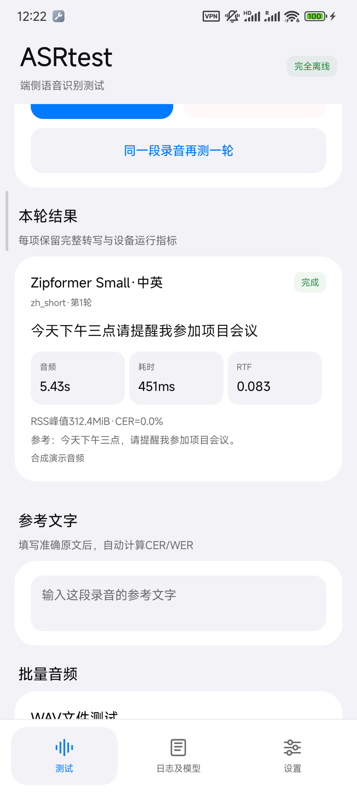

<p align="center"></p>
<h1 align="center">ASRtest</h1>
<p align="center">在Android、iPhone和iPad上，离线比较八组语音识别模型。</p>
<p align="center">
  <a href="CHANGELOG.md"></a>
  <a href="#运行要求"></a>
  <a href="LICENSE"></a>
  <a href="https://github.com/Roylyl/ASRtest/stargazers"></a>
  <a href="https://github.com/Roylyl/ASRtest/issues"></a>
</p>
<p align="center"><a href="#快速开始">快速开始</a> · <a href="#主要功能">主要功能</a> · <a href="#模型">模型</a> · <a href="#界面预览">界面预览</a> · <a href="#开发">开发</a> · <a href="#许可与来源">许可与来源</a></p>

ASRtest面向端侧语音识别选型与开发，用统一的录音、转写和日志界面对比不同模型的识别表现与运行开销。手机App内置八组模型及必要运行库，安装后即可离线切换使用，无需下载或导入模型，音频不上传服务器。
Android与iOS共用一个源码仓库和一份模型资源，分别构建各自的App。项目另提供Apple Watch配套应用，使用独立的watchOS运行库和Whisper tiny模型。

## 快速开始

### 获取源码和模型

先安装Git LFS，再获取完整文件：

```sh
git lfs install
git clone https://github.com/Roylyl/ASRtest.git
cd ASRtest
git lfs pull
```

大型模型和预编译运行库通过Git LFS保存。首次获取源码和解析构建依赖需要网络，App识别在本机完成。以下命令均从仓库根目录执行。

### iPhone与iPad

1. 用Xcode打开`apps/ios/ASRtest.xcodeproj`。
2. 将`apps/ios/Config/Local.xcconfig.example`复制为同目录的`Local.xcconfig`，填写自己的开发团队和唯一Bundle Identifier。个人签名配置不会进入Git。
3. 选择`ASRtest` Scheme和目标设备运行，首次使用允许麦克风访问。
4. 在“设置”选择模型，回到“测试”开始录音；结果和耗时会显示在页面上，并保存到日志。

命令行无签名构建：

```sh
./Scripts/build-ios.sh
```

### Android

1. 用Android Studio打开`apps/android`，将Gradle JDK设置为JDK17，安装Android SDK35。使用命令行时，`JAVA_HOME`也应指向JDK17。
2. 连接开启USB调试的arm64手机，选择`app`运行。
3. 在“设置”选择模型，在“测试”录音；也可选择多个模型依次识别同一段录音。

命令行构建并安装Debug APK：

```sh
./Scripts/build-android.sh
adb install -r -g apps/android/app/build/outputs/apk/debug/app-debug.apk
```

更多构建配置、演示语料与指标说明见[Android开发说明](docs/Android.md)。

## 运行要求

|平台|要求|
|---|---|
|iPhone/iPad|iOS17及以上；Xcode与对应SDK；安装到设备需要开发签名|
|iOS Simulator|Apple Silicon Mac与arm64 Simulator；现有依赖组合不支持x86_64 Simulator|
|Android|Android8.0及以上、arm64-v8a；开发使用JDK17、SDK35、Gradle8.10.2|
|Apple Watch|watchOS10及以上；配对iPhone与Watch均需开发签名；录音入口仅在Debug构建开放|

八组模型的必要文件合计约1.857GB。构建缓存、安装包和Android私有目录中的模型副本另占存储空间。

## 主要功能

|页面|用途|
|---|---|
|测试|开始/停止录音，显示转写文字、音频时长、识别耗时及运行状态|
|日志及模型信息|查看完整转写、状态和错误，浏览模型来源，删除记录或导出JSON/JSONL日志ZIP|
|设置|切换模型，调整支持的语言、CPU线程与SenseVoice ITN；iOS还可选择麦克风输入源|

单模型录音时，流式模型边录边显示文字，非流式模型在停止后转写。流式录音最长600秒，非流式录音与Android多模型比较最长30秒。每轮固定模型与识别设置，手机端每次只加载一个模型。

- iOS：单文件与多选WAV逐文件识别、独立批量组日志、同一批音频切换模型重测，以及iPad宽屏控制与转写双栏。
- Android：同一句录音多模型比较、保留录音重测、多选WAV处理，以及内置演示语料的自动评测。
- 日志：保存结果与过程记录，ZIP导出保留记录关联，不包含模型和原始音频。

Apple Watch提供Whisper tiny的实验录音入口，使用独立的watchOS CPU运行库，仅在Debug构建开放录音，其他模型在手表上不可用。手表日志先在本地保存，用户点击导出后传给配对iPhone，在手机日志页中查看；排队、传送完成和iPhone入库确认分别显示。使用条件与接入说明见[Watch文档](apps/ios/WatchWhisperRuntime/README.md)。

## 模型

权重统一位于`shared/assets/ModelLibrary/`，八组模型均随iOS与Android手机App打包。下表大小为必要模型文件的十进制MB，安装体积和运行内存另计。

|模型|推理框架|语言与方式|文件大小|目录|
|---|---|---|---:|---|
|Zipformer Small，2023-02-16/chunk32|sherpa-onnx/ONNX Runtime|中英，原生流式|60.14MB|`zipformer`|
|Whisper tiny multilingual|whisper.cpp|多语言，停止后转写|77.69MB|`whisperTiny`|
|Whisper base multilingual|whisper.cpp|多语言，停止后转写|147.95MB|`whisperBase`|
|Vosk small-cn-0.22|Vosk|中文，流式|68.29MB|`voskChinese`|
|Vosk small-en-us-0.15|Vosk|英文，流式|70.90MB|`voskEnglish`|
|SenseVoiceSmall INT8|sherpa-onnx Offline API|中、英、粤、日、韩，停止后转写|239.55MB|`senseVoice`|
|Paraformer Streaming INT8|sherpa-onnx Online API|中英，原生流式|237.20MB|`paraformer`|
|Fun-ASR-Nano Q4|原生Fun-ASR/llama.cpp/GGML|中、英、日，停止后本地VAD分段转写|955.27MB|`nano`|

Whisper提供自动、中文和英文选项。Vosk使用对应单语言模型，线程由运行库管理。Nano为实验性CPU移植，使用配套encoder/adaptor、Q4_K_M解码器与FSMN-VAD，停止后分段转写。

## 界面预览

<table>
  <tr>
    <td align="center"><br><sub>iOS测试</sub></td>
    <td align="center"><br><sub>iOS深色</sub></td>
    <td align="center"><br><sub>iOS模型选择</sub></td>
  </tr>
  <tr>
    <td align="center"><br><sub>Android测试</sub></td>
    <td align="center"><br><sub>Android日志</sub></td>
    <td align="center"><br><sub>Android模型比较</sub></td>
  </tr>
</table>

iOS采用原生Tab Bar与系统导航，支持的系统上使用液态玻璃；Android采用分组卡片并支持深色模式。更多截图见[iOS截图](docs/screenshots/ios/)与[Android截图](docs/screenshots/android/)。

## 开发

```text
ASRtest/
├── apps/ios/                 # Xcode工程、Swift源码、Watch和iOS运行库
├── apps/android/             # Gradle工程、Kotlin源码、JNI和Android运行库
├── shared/assets/            # 八组模型、模型清单、演示音频及参考文字
├── Vendor/                   # 固定版本的第三方源码
├── Scripts/                  # 两平台构建入口和运行库构建工具
├── docs/                     # 开发资料与界面截图
└── Licenses/                 # 框架、运行库与模型许可
```

两端共用同版本Whisper与Nano上游源码，各自保留Swift/JNI封装及平台二进制。iOS、watchOS和Android运行库分别构建，不能互换。

|开发资料|内容|
|---|---|
|[模型清单](shared/assets/ModelsManifest.json)|模型版本、来源与必要文件|
|[iOS运行库清单](apps/ios/RuntimeArtifactsManifest.json)|预编译运行库与来源|
|[Android开发说明](docs/Android.md)|构建、语料、指标与原生运行库|
|[Watch运行库说明](apps/ios/WatchWhisperRuntime/README.md)|watchOS专用Whisper构建|
|[贡献说明](CONTRIBUTING.md)|修改约定与第三方内容要求|

## 许可与来源

ASRtest原创App源码采用[Apache License 2.0](LICENSE)。第三方源码、运行库和模型权重保留各自许可，项目许可证不覆盖这些内容。使用或再分发时请查阅[第三方说明](THIRD_PARTY_NOTICES.md)、[Vendor源码来源](Vendor/SOURCES.md)和[Android后端来源](Licenses/android/ENGINE-DEPENDENCIES.md)，原始许可保存在[Licenses](Licenses/)及各上游源码目录。

模型与框架来源：[sherpa-onnx](https://github.com/k2-fsa/sherpa-onnx)、[whisper.cpp](https://github.com/ggml-org/whisper.cpp)、[Vosk](https://github.com/alphacep/vosk-api)、[SenseVoice](https://github.com/QwenAudio/SenseVoice)、[FunASR](https://github.com/modelscope/FunASR)、[Fun-ASR](https://github.com/QwenAudio/Fun-ASR)。
