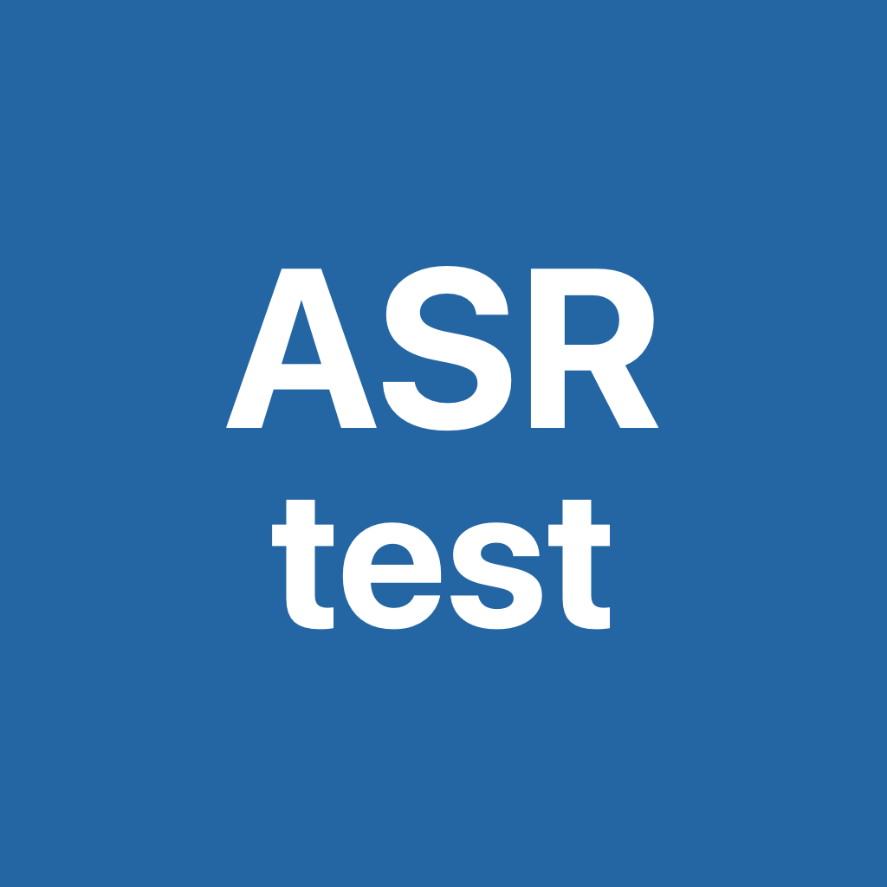
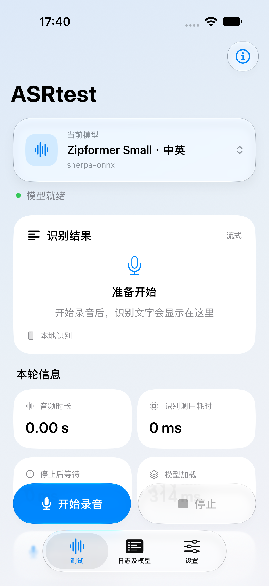
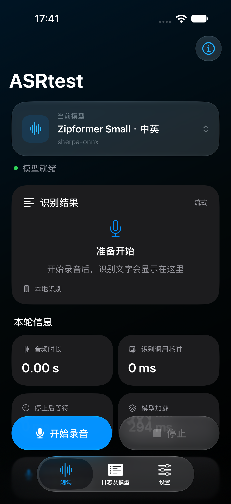
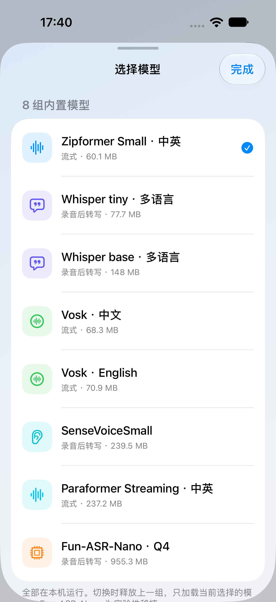
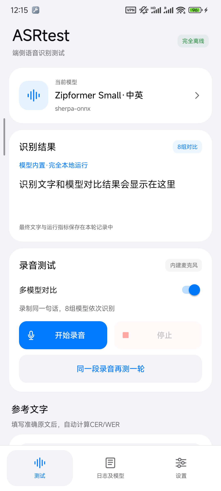
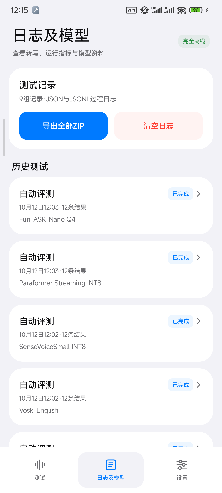
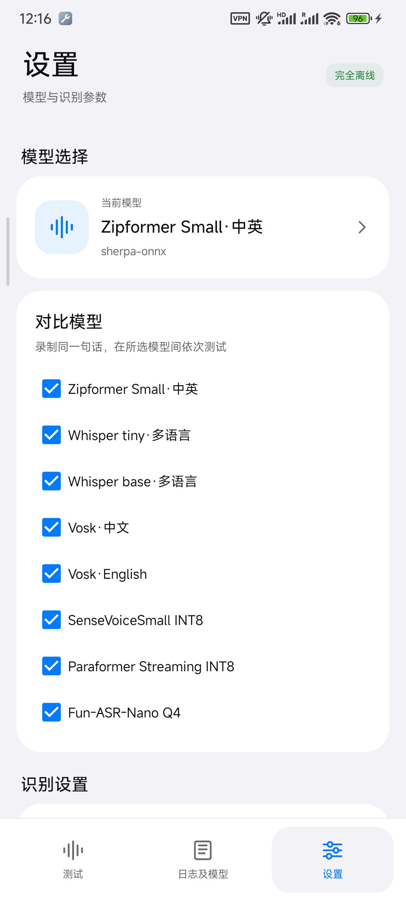

<p align="center"></p>

<h1 align="center">ASRtest</h1>
<p align="center">Android、iPhone与iPad的离线语音识别模型对比工具，附Apple Watch实验入口。</p>
<p align="center">
  <a href="apps/ios/ASRtest.xcodeproj/project.pbxproj"></a>
  <a href="apps/android/app/build.gradle"></a>
  <a href="#运行要求"></a>
  <a href="LICENSE"></a>
  <a href="https://github.com/Roylyl/ASRtest/issues"></a>
</p>
<p align="center"><a href="#快速开始">快速开始</a> · <a href="#主要功能">主要功能</a> · <a href="#八组模型">八组模型</a> · <a href="#界面预览">界面预览</a> · <a href="#开发与目录">开发与目录</a> · <a href="#许可与来源">许可与来源</a></p>

ASRtest用于在设备上比较不同ASR模型的转写、流式表现和运行开销。八组模型及必要运行库随手机App集成，使用统一的录音、模型切换和日志界面。识别完全在本机执行，不上传音频，也不依赖云端ASR。

Android与iOS源码在同一个仓库独立构建，共用模型权重、来源记录和演示语料。配套Watch App仅包含Whisper tiny，使用单独构建的watchOS运行库。

## 快速开始

先安装Git LFS，再获取完整源码与模型：

```sh
git lfs install
git clone https://github.com/Roylyl/ASRtest.git
cd ASRtest
git lfs pull
```

普通源码由Git管理，大型模型和预编译运行库由Git LFS管理。构建前需要获取完整LFS文件；App运行时无需下载或导入模型。第一次解析SwiftPM或Gradle依赖需要网络。

### iOS

1. 用Xcode打开`apps/ios/ASRtest.xcodeproj`，选择`ASRtest` Scheme。
2. 将`apps/ios/Config/Local.xcconfig.example`复制为同目录的`Local.xcconfig`，填写自己的开发团队和唯一Bundle Identifier。个人配置已被Git忽略。
3. 选择iPhone、iPad或Apple Silicon上的arm64 Simulator运行。首次使用允许麦克风访问，在“设置”中切换模型。

从仓库根目录执行无签名设备构建：

```sh
./Scripts/build-ios.sh
```

### Android

1. 用Android Studio打开`apps/android`，将Gradle JDK设置为JDK17，安装Android SDK35。
2. 连接开启USB调试的arm64手机，选择`app`运行。
3. 在“设置”选择模型；测试页可单模型录音，也可让多个模型依次识别同一句录音。

从仓库根目录构建及安装Debug APK：

```sh
./Scripts/build-android.sh
adb install -r -g apps/android/app/build/outputs/apk/debug/app-debug.apk
```

详细评测、指标口径和原生运行库重建见[Android开发说明](docs/Android.md)。APK是本地构建产物，不纳入源码仓库。

## 运行要求

|平台|要求|
|---|---|
|iPhone/iPad|iOS17及以上；Xcode与对应SDK；真机运行需要自己的开发签名|
|iOS Simulator|Apple Silicon Mac、arm64 Simulator；现有iOS依赖不提供完整x86_64 Simulator组合|
|Android|Android8.0及以上、arm64-v8a；开发使用JDK17、SDK35、Gradle8.10.2|
|Apple Watch|watchOS10及以上；配对iPhone与Watch均需有效签名；当前为实验入口|

八组必要模型合计约1.857GB。构建缓存、安装包及Android私有目录中的模型副本另占存储空间；Nano模型约955MB。

## 主要功能

|页面|用途|
|---|---|
|测试|开始/停止录音、完整转写、真实流式中间结果或停止后的最终结果、音频时长及识别耗时|
|日志及模型信息|历史转写、状态与错误、模型来源；删除记录与导出JSON/JSONL日志ZIP|
|设置|模型切换、适用模型的语言、线程及SenseVoice ITN；iOS可切换麦克风输入源|

iOS支持单文件与多选WAV逐文件识别、批量组日志、同一批音频切换模型重测，以及iPad宽屏控制与结果双栏。Android支持同一句录音多模型对比、保留录音重测、多选WAV处理及内置演示语料自动评测。两端保留各模型真实的流式和非流式差异。

手机端每次只加载一个模型。单模型流式录音上限600秒，非流式及Android多模型比较单轮上限30秒。模型切换先释放当前识别器；录音及识别期间固定本轮配置。日志ZIP保留结果与过程记录，不混入模型或原始音频。

## 八组模型

模型大小为对应配置必要文件的十进制MB，不是安装体积或运行内存。权重统一位于`shared/assets/ModelLibrary/`。

|模型|推理框架|语言与方式|文件大小|目录|
|---|---|---|---:|---|
|Zipformer Small，2023-02-16/chunk32|sherpa-onnx/ONNX Runtime|中英，原生流式|60.14MB|`zipformer`|
|Whisper tiny multilingual|whisper.cpp|多语言，停止后转写|77.69MB|`whisperTiny`|
|Whisper base multilingual|whisper.cpp|多语言，停止后转写|147.95MB|`whisperBase`|
|Vosk small-cn-0.22|Vosk|中文，流式|68.29MB|`voskChinese`|
|Vosk small-en-us-0.15|Vosk|英文，流式|70.90MB|`voskEnglish`|
|SenseVoiceSmall INT8|sherpa-onnx Offline API|中、英、粤、日、韩，停止后转写|239.55MB|`senseVoice`|
|Paraformer Streaming INT8|sherpa-onnx Online API|中英，原生流式|237.20MB|`paraformer`|
|Fun-ASR-Nano Q4|原生Fun-ASR/llama.cpp/GGML|中、英、日，停止后本地VAD分段转写|955.27MB|`nano`|

Whisper UI提供自动、中文和英文选项。Vosk线程由运行库管理，通用线程设置不作为其实际生效线程数。Nano为实验性CPU移植，使用官方配套encoder/adaptor、Q4_K_M解码器和FSMN-VAD。

Watch只打包Whisper tiny，不调用iPhone代算。当前Debug提供实验录音入口，Release禁用录音；实体手表本地推理仍需完成确认。其他模型在Watch端标为不可用。手表日志先本地保存，用户导出后通过WatchConnectivity传至iPhone，区分排队、传送完成和iPhone入库确认。

## 界面预览

<table>
  <tr>
    <td align="center"><br><sub>iOS测试</sub></td>
    <td align="center"><br><sub>iOS深色</sub></td>
    <td align="center"><br><sub>iOS模型选择</sub></td>
  </tr>
  <tr>
    <td align="center"><br><sub>Android测试</sub></td>
    <td align="center"><br><sub>Android日志</sub></td>
    <td align="center"><br><sub>Android设置</sub></td>
  </tr>
</table>

iOS沿用原生Tab Bar、系统导航与适用系统上的液态玻璃按钮；Android使用蓝白分组卡片并适配系统深色模式。更多截图见[iOS截图](docs/screenshots/ios/)与[Android截图](docs/screenshots/android/)。

## 开发与目录

```text
ASRtest/
├── apps/ios/                 # Xcode工程、Swift源码、Watch、Swift包及iOS运行库
├── apps/android/             # Gradle工程、Kotlin源码、JNI及Android运行库
├── shared/assets/            # 八组模型、唯一模型清单、演示音频及参考文字
├── Vendor/                   # 固定版本的第三方源码快照
├── Scripts/                  # 两平台构建入口及iOS运行库构建工具
├── docs/                     # 开发资料与两平台截图
└── Licenses/                 # 框架、运行库和模型许可原文
```

模型元数据见[ModelsManifest.json](shared/assets/ModelsManifest.json)，iOS预编译产物信息见[RuntimeArtifactsManifest.json](apps/ios/RuntimeArtifactsManifest.json)。同版本Whisper与Nano上游源码共用根目录`Vendor/`；Swift、JNI封装和各平台二进制独立保留。iOS XCFramework不能作为Android或watchOS运行库使用。

从仓库根目录重建Nano或Whisper的iOS运行库：

```sh
python3 Scripts/build-nano.py
python3 Scripts/build-whisper.py
```

Watch与Android原生构建说明分别见[WatchWhisperRuntime](apps/ios/WatchWhisperRuntime/README.md)和[Android原生来源](apps/android/native/SOURCES.md)。参与开发请阅读[CONTRIBUTING.md](CONTRIBUTING.md)。

## 许可与来源

ASRtest原创App源码采用[Apache License 2.0](LICENSE)。第三方源码、运行库和权重分别适用自身条款，项目许可证不覆盖它们。

完整说明见[THIRD_PARTY_NOTICES.md](THIRD_PARTY_NOTICES.md)、[Vendor源码来源](Vendor/SOURCES.md)及[Android后端来源](Licenses/android/ENGINE-DEPENDENCIES.md)。SenseVoice固定ONNX权重的授权范围、iOS社区Vosk二进制的底层来源与传递依赖告知仍需在公开分发对应资源前补齐；Git LFS和格式转换不改变再分发义务。

模型和框架来源：[sherpa-onnx](https://github.com/k2-fsa/sherpa-onnx)、[whisper.cpp](https://github.com/ggml-org/whisper.cpp)、[Vosk](https://github.com/alphacep/vosk-api)、[SenseVoice](https://github.com/QwenAudio/SenseVoice)、[FunASR](https://github.com/modelscope/FunASR)、[Fun-ASR](https://github.com/QwenAudio/Fun-ASR)。
